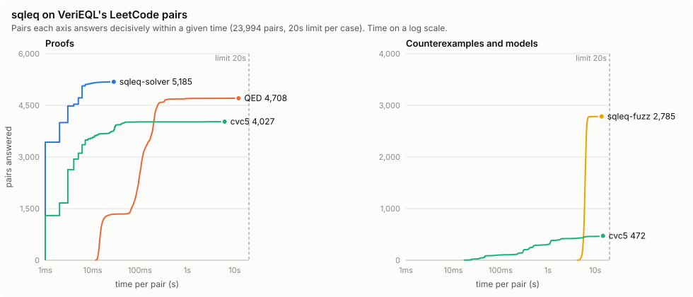

# VeriEQL's LeetCode pairs

[VeriEQL](https://github.com/VeriEQL/VeriEQL) (He, Zhao, Wang and Wang,
[OOPSLA 2024](https://doi.org/10.1145/3649849)) published 23,994 pairs of LeetCode answers, each
with its tables, their constraints and VeriEQL's own answer. Two scripts make them a benchmark for
every axis here:

```sh
python3 tools/verieql_leetcode.py      # fetch VeriEQL's file (35 MB) and write target/verieql/leetcode/
L=target/verieql/leetcode; mkdir -p $L/runs
for axis in sqleq-solver qed fuzz cvc5; do
  sqleq-check --expect report-only --no-retry -q -t 20 -j 12 --axes frontend,$axis \
    --jsonl $L/runs/$axis.jsonl --resume $L/cases
done
python3 tools/verieql_report.py $L/manifest.jsonl $L/runs/*.jsonl --timeout 20 --svg cactus.svg
```

Leave out an axis you have not built: `qed` needs the QED prover
([check.md](check.md#second-opinion-the-qed-prover)), `cvc5` needs `sh tools/build_cvc5.sh`
([CVC5.md](CVC5.md)). `--no-retry` matters: without it, every case that timed out runs again, one
at a time. Both scripts are Python 3, standard library only.

VeriEQL's data is licensed [CC BY-NC-SA 4.0](https://creativecommons.org/licenses/by-nc-sa/4.0/):
non-commercial use only, and anything shared from it is under the same license. So this repository
holds none of it, not even an example. The script downloads `experiments/2025_10_31/leetcode.out` at
a pinned commit, checks its SHA-256 digest, and writes under `target/` only. Whoever runs it uses
VeriEQL's data under that license. Name a pair by its file, such as `1050/00020`, and do not commit
or post its queries.

## A pair

This line is made up; VeriEQL's lines have these fields and a few more:

```json
{"index": 0, "file": "benchmark/leetcode/raw_data/0.csv",
 "pair": ["SELECT CITY FROM SHOPS WHERE ID NOT IN (SELECT SHOPID FROM SALES)",
          "SELECT CITY FROM SHOPS WHERE NOT EXISTS (SELECT 1 FROM SALES WHERE SALES.SHOPID = SHOPS.ID)"],
 "schema": {"SHOPS": {"ID": "INT", "CITY": "VARCHAR"}, "SALES": {"ID": "INT", "SHOPID": null}},
 "constraint": [{"primary": [{"value": "SHOPS__ID"}]}, {"primary": [{"value": "SALES__ID"}]},
                {"foreign": [{"value": "SALES__SHOPID"}, {"value": "SHOPS__ID"}]}],
 "states": ["EQU", "EQU", "TMO"], "times": [[0.04], [0.71], [600.0]]}
```

It becomes `target/verieql/leetcode/cases/0/00000.sql`:

```sql
-- VeriEQL LeetCode pair 0, problem 0.
-- VeriEQL answered TMO in 600.75s.

create table "shops" (
  "id" INTEGER NOT NULL,
  "city" VARCHAR,
  PRIMARY KEY ("id")
);
create table "sales" (
  "id" INTEGER NOT NULL,
  "shopid" INTEGER NOT NULL,
  PRIMARY KEY ("id"),
  FOREIGN KEY ("shopid") REFERENCES "shops" ("id")
);
SELECT CITY FROM SHOPS WHERE ID NOT IN (SELECT SHOPID FROM SALES);
SELECT CITY FROM SHOPS WHERE NOT EXISTS (SELECT 1 FROM SALES WHERE SALES.SHOPID = SHOPS.ID);
```

`states` holds VeriEQL's answer with up to 1 row per table, then 2, and so on: here no
counterexample with up to 2 rows, and out of time at 3. `sqleq-solver` proves the pair in 2 ms. The
`NOT NULL` on `shopid` matters: without it, a sale with a NULL `shopid` empties the first query, and
`sqleq-fuzz` finds one.

The queries are copied as VeriEQL has them: upper-cased, and in MySQL's dialect. The constraints
become:

| VeriEQL | here |
|---|---|
| `INT`, `BOOL`, no type | `INTEGER`: VeriEQL reads all three as integers |
| `VARCHAR`, `ENUM,a,b` | `VARCHAR`: VeriEQL does not hold an enum to its values |
| `primary [a, b]` | `PRIMARY KEY (a, b)`; a table's second key is `UNIQUE` and NOT NULL |
| `foreign [c, p]` | `c` NOT NULL, and `FOREIGN KEY (c) REFERENCES t (p)` when `p` is a key of `t` |
| `gt [a, 0]`, `in`, `between` | `CHECK (a > 0)`, and `a` NOT NULL |
| `lt [a, b]`, `neq [a, b]` | `CHECK (a < b)`, and `a`, `b` NOT NULL |
| `imply`, `inc`, `consec` | dropped |

The NOT NULLs are VeriEQL's: it reads every comparison, a reference included, as false on NULL.
Every constraint written is one VeriEQL assumes too, so a proof here holds under VeriEQL's
constraints. A counterexample may break one that was dropped. Three things are dropped:

* 2,732 references to a column that is not a key, which SQL cannot state;
* 2,338 `imply`, 471 `inc` and 471 `consec`, which no `CREATE TABLE` can state;
* VeriEQL's column comparisons, which hold between any two rows of the table. A `CHECK` holds within
  a row only.

`target/verieql/leetcode/manifest.jsonl` lists each pair's dropped constraints, and so does the
pair file's header.

## Results

Run on 2026-11-18: sqleq at cacf947, cvc5 `bags-algebra` at 249a95c (the commit
[`tools/build_cvc5.sh`](../tools/build_cvc5.sh) pins), the QED prover 0.1.0 from Nix, and
PostgreSQL 17.11. Apple M5 Max (6 performance and 12 efficiency cores), 20s per pair per axis,
`-j 12` (`-j 14` for cvc5).



Each curve is one axis's decisive answers, sorted by time: a proof for a prover, a counterexample
for `sqleq-fuzz`, a model for cvc5 (a refutation of the plan, not of the pair: [CVC5.md](CVC5.md)).

| axis | decisive | no answer | timeout | crash or error | declined | stage |
|---|---|---|---|---|---|---|
| frontend | 11,300 lowered (1,297 to one plan) | | | | 12,694 refused | 53s |
| sqleq-solver | 5,185 proved | 5,720 | 0 | 0 | 13,089 | 3m44s |
| QED | 4,708 proved | 6,425 | 63 | 104 | 12,694 | 10m34s |
| cvc5 | 4,027 proved, 472 models | 925 | 4,875 | 466 | 13,229 | 1h39m |
| sqleq-fuzz | 2,785 counterexamples | 11,854 | | 8,399 | 956 | 3h27m |

A prover declines a pair the frontend refused or a plan it cannot read; `sqleq-fuzz` declines a pair
whose two sides it cannot compare (785) or that is not deterministic (171). "Stage" is the wall time
of the axis's whole run.

The three provers prove 5,389 pairs between them: 3,388 all three, 119 `sqleq-solver` alone, 71 QED
alone, 56 cvc5 alone. No pair has both a proof and a counterexample, cvc5's included, and no cvc5
model meets a proof.

Against VeriEQL's answers ("proved" is `sqleq-solver` or QED):

| VeriEQL | proved | proved by cvc5 only | counterexample | undecided | refused | pairs |
|---|---|---|---|---|---|---|
| `TMO`: no counterexample in 600s | 5,226 | 50 | 392 | 2,214 | 7,020 | 14,902 |
| `NEQ`: a counterexample | 0 | 0 | 1,729 | 802 | 1,055 | 3,586 |
| `NIE`: not implemented | 11 | 6 | 465 | 885 | 1,320 | 2,687 |
| `NSE`: not supported | 87 | 0 | 183 | 392 | 1,261 | 1,923 |
| `SYN`: a syntax error | 15 | 0 | 16 | 56 | 802 | 889 |
| `OTE`, `OOM` | 0 | 0 | 0 | 0 | 7 | 7 |
| **all** | **5,339** | **56** | **2,785** | **4,349** | **11,465** | **23,994** |

No prover proves a pair VeriEQL refuted. Of the 392 `TMO` pairs `sqleq-fuzz` refutes, 210 (problems
1211 and 1075) divide two integers, which truncates in Postgres and not in MySQL, and 69 differ on
an empty table.

Why the frontend refused:

| reason | pairs |
|---|---|
| `GROUP BY 1`: a position | 3,789 |
| a numeric value read by a function not known to give equal results on 2.0 and 2.00, such as `ROUND(AVG(x), 2)` | 2,043 |
| a column not in the `GROUP BY`, which MySQL allows | 2,002 |
| syntax Postgres does not parse | 1,856 |
| window functions | 1,354 |
| a table or column the schema does not have | 594 |
| a value of a type the frontend does not know | 557 |
| other | 499 |

## Reading the results

* **The queries are MySQL's, read as Postgres.** Postgres rejects a column not in the `GROUP BY`,
  `IF(…)`, `IFNULL(…)`, `DATEDIFF(…)`, `SUM` of a comparison and `"Yes"` as a string, so
  `sqleq-fuzz` answers `error` on 8,399 pairs. The frontend reads an unknown function as opaque, so
  it lowers some of these pairs anyway.
* **The semantics are Postgres's.** `a / b` on two integer columns truncates here and not in
  MySQL, so a pair can be equivalent in one and not the other.
* **VeriEQL's `TMO` is not a truth.** It means no counterexample up to the bound VeriEQL reached in
  600s. Only its `NEQ` is a claim.
* **VeriEQL's times are from its own run**, on other hardware, and are not plotted.
